```{=html}
<link rel="stylesheet"
  href="https://cdnjs.cloudflare.com/ajax/libs/leaflet/1.9.4/leaflet.css">
<style>
  #route-map {
    --map-bg: #ffffff; --ink: #1a1a1a; --accent: #FF4834;
    height: clamp(480px, 88vh, 900px); width: 100%; background: var(--map-bg);
    font-family: inherit; position: relative; isolation: isolate;
  }
  body.quarto-dark #route-map { --map-bg: #1a1a1a; --ink: #e8e2e0; }
  /* Mountains: greyscale hillshade with the contrast stretched, blended into
     the page colour (inverted onto dark). */
  #route-map .relief { filter: url(#relief-light); mix-blend-mode: multiply;
    opacity: .7; }
  body.quarto-dark #route-map .relief { filter: url(#relief-dark);
    mix-blend-mode: screen; opacity: .8; }
  /* Lakes: the water-blue pixels of the OSM layer, keyed out and recoloured;
     roads, labels and land cover are discarded. */
  #route-map .water { filter: url(#lake-light); }
  body.quarto-dark #route-map .water { filter: url(#lake-dark); }
  /* Tiles are fetched one zoom finer (half-size, so 4x detail). Leaflet's
     plus-lighter tile blend leaves light seams once the layers are filtered. */
  #route-map img.leaflet-tile { mix-blend-mode: normal; }
  #route-map .leaflet-control-attribution {
    background: none; color: var(--ink); opacity: .55; font-size: 10px; }
  #route-map .leaflet-control-attribution a { color: inherit; }
  #route-map .leaflet-bar a { background: var(--map-bg); color: var(--ink);
    border-color: color-mix(in srgb, var(--ink) 25%, transparent); }
  #route-map .camp { width: 20px; height: 20px; border-radius: 50%;
    background: var(--accent); color: #fff; font: 700 11px/20px sans-serif;
    text-align: center; box-shadow: 0 0 0 2px var(--map-bg); }
  #route-map .leaflet-tooltip { background: var(--map-bg); color: var(--ink);
    border: 0; box-shadow: 0 1px 4px rgba(0,0,0,.3); font-size: 13px; }
  #route-map .leaflet-tooltip::before { display: none; }
  #route-map .place { background: none; box-shadow: none; font-weight: 600;
    letter-spacing: .02em; padding: 0;
    text-shadow: 0 0 3px var(--map-bg), 0 0 3px var(--map-bg), 0 0 6px var(--map-bg); }
  #route-map .place.peak { font-weight: 400; font-style: italic; }
</style>
<svg width="0" height="0" style="position:absolute" aria-hidden="true">
  <filter id="relief-light" color-interpolation-filters="sRGB">
    <feColorMatrix type="saturate" values="0"/>
    <feComponentTransfer>
      <feFuncR type="linear" slope="4.4" intercept="-3.4"/>
      <feFuncG type="linear" slope="4.4" intercept="-3.4"/>
      <feFuncB type="linear" slope="4.4" intercept="-3.4"/>
    </feComponentTransfer>
  </filter>
  <filter id="relief-dark" color-interpolation-filters="sRGB">
    <feColorMatrix type="saturate" values="0"/>
    <feComponentTransfer>
      <feFuncR type="linear" slope="-3" intercept="3"/>
      <feFuncG type="linear" slope="-3" intercept="3"/>
      <feFuncB type="linear" slope="-3" intercept="3"/>
    </feComponentTransfer>
  </filter>
  <filter id="lake-light" color-interpolation-filters="sRGB">
    <!-- alpha := blue minus red; keep only the narrow band water falls in -->
    <feColorMatrix type="matrix"
      values="0 0 0 0 0.35  0 0 0 0 0.37  0 0 0 0 0.42  -1 0 1 0 0"/>
    <feComponentTransfer>
      <feFuncA type="table"
        tableValues="0 0 0 0.6 1 1 1 0.5 0 0 0 0 0 0 0 0 0 0 0 0 0"/>
    </feComponentTransfer>
  </filter>
  <filter id="lake-dark" color-interpolation-filters="sRGB">
    <!-- alpha := blue minus red; keep only the narrow band water falls in -->
    <feColorMatrix type="matrix"
      values="0 0 0 0 0.62  0 0 0 0 0.64  0 0 0 0 0.68  -1 0 1 0 0"/>
    <feComponentTransfer>
      <feFuncA type="table"
        tableValues="0 0 0 0.6 1 1 1 0.5 0 0 0 0 0 0 0 0 0 0 0 0 0"/>
    </feComponentTransfer>
  </filter>
</svg>
<div class="column-page" style="margin-bottom: 2.5rem">
  <div id="route-map" role="img"
       aria-label="Relief map of our route from Abisko in the north to Kvikkjokk
                   in the south, with numbered camps"></div>
</div>
<script src="https://cdnjs.cloudflare.com/ajax/libs/leaflet/1.9.4/leaflet.js">
</script>
<script>
(async () => {
  const el = document.getElementById("route-map");
  const url = new URL("assets/route.geojson", document.baseURI).href;
  const data = await (await fetch(url)).json();
  const map = L.map(el, { scrollWheelZoom: false, zoomSnap: 1,
    minZoom: 6, maxZoom: 12 }).setView([67.7, 18.3], 8);
  const esri = "https://server.arcgisonline.com/ArcGIS/rest/services/";
  L.tileLayer("https://tile.openstreetmap.org/{z}/{x}/{y}.png", {
    className: "water", tileSize: 128, zoomOffset: 1, maxNativeZoom: 18,
    attribution: "Lakes &copy; <a href='https://openstreetmap.org/copyright'>" +
      "OpenStreetMap</a> contributors",
  }).addTo(map);
  L.tileLayer(esri + "Elevation/World_Hillshade/MapServer/tile/{z}/{y}/{x}", {
    className: "relief", tileSize: 128, zoomOffset: 1, maxNativeZoom: 12,
    attribution: "Relief &copy; Esri, USGS, NOAA, NASA, NGA",
  }).addTo(map);

  const fmt = (iso) => new Date(iso + "T12:00:00Z").toLocaleDateString("en-GB",
    { weekday: "short", day: "numeric", month: "short", timeZone: "UTC" });
  const ll = ([lon, lat]) => [lat, lon];
  const days = data.features.filter((f) => f.properties.kind === "day");
  const gaps = data.features.filter((f) => f.properties.kind === "gap");
  const accent = "#FF4834";
  const bg = () => document.body.classList.contains("quarto-dark") ? "#1a1a1a" : "#fff";

  const group = L.featureGroup().addTo(map);
  const casings = [];
  const casing = (coords, w) => casings.push(L.polyline(coords,
    { color: bg(), weight: w, opacity: 0.85, lineJoin: "round" }).addTo(group));

  for (const f of days) {
    const coords = f.geometry.coordinates.map((c) => c.map(ll));
    casing(coords, 7);
    L.polyline(coords, { color: accent, weight: 3, lineJoin: "round" })
      .addTo(group).bindTooltip(
        `Day ${f.properties.day} &middot; ${fmt(f.properties.date)} &middot; ` +
        `${f.properties.km} km &middot; up to ${f.properties.max_ele} m`,
        { sticky: true });
  }
  for (const g of gaps) {
    const coords = g.geometry.coordinates.map(ll);
    casing(coords, 6);
    L.polyline(coords, { color: accent, weight: 2.5, dashArray: "1 7",
      lineCap: "round" }).addTo(group);
  }
  new MutationObserver(() => casings.forEach((c) => c.setStyle({ color: bg() })))
    .observe(document.body, { attributes: true, attributeFilter: ["class"] });

  const first = (f) => f.geometry.coordinates[0][0];
  const lastOf = (f) => f.geometry.coordinates.at(-1).at(-1);
  const label = (lonlat, text, dir, cls = "") => L.marker(ll(lonlat), {
    icon: L.divIcon({ className: "", iconSize: [0, 0] }), interactive: false,
  }).bindTooltip(text, { permanent: true, direction: dir, className: "place " + cls,
    offset: dir === "left" ? [-6, 0] : [6, 0] }).addTo(map);

  // Night N is spent where day N+1 starts (equals where day N ends unless the
  // logger was off, as it was before Saltoluokta).
  const places = { 8: "Saltoluokta" };
  days.slice(0, -1).forEach((f, i) => {
    const n = f.properties.day;
    L.marker(ll(first(days[i + 1])), { icon: L.divIcon({ className: "",
      iconSize: [20, 20], html: `<div class="camp">${n}</div>` }) })
      .bindTooltip(`Camp ${n}` + (places[n] ? ` &middot; ${places[n]}` : ""),
        { direction: "top", offset: [0, -8] }).addTo(map);
  });
  label(first(days[0]), "Abisko", "left");
  label(lastOf(days.at(-1)), "Kvikkjokk", "right");
  label([18.5133, 67.9033], "Kebnekaise", "right", "peak");

  const fit = () => map.fitBounds(group.getBounds(), { padding: [16, 16] });
  fit();
  // The column is laid out after this script runs; keep the map in step with
  // its container and re-fit until the reader starts exploring.
  let explored = false;
  for (const ev of ["pointerdown", "wheel", "keydown"])
    el.addEventListener(ev, () => { explored = true; }, { passive: true });
  new ResizeObserver(() => {
    map.invalidateSize({ pan: false });
    if (!explored) fit();
  }).observe(el);
  map.on("click", () => map.scrollWheelZoom.enable());
})();
</script>
```

:::{.column-page}
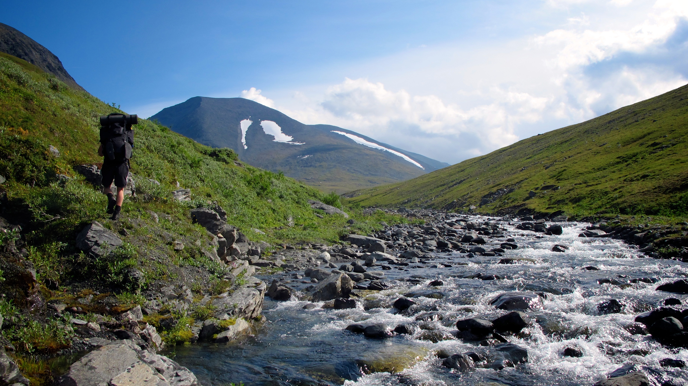{width=100%}
:::

In February, I found an unexpected email in my inbox. Just a cryptic question,
'Do you still have your old backpack?' It was Niklas, a Swedish friend of mine,
and I knew what he was getting at. We'd talked about heading north to see the
[Scandinavian mountains][wiki-sm] (_Fjällen_) back when I lived in Stockholm but
never organised it. This time we made the plans and in August I was stood with
Nik and the old backpack at Stockholm's Central Station, ready to make the long
journey north. 

<!-- ## On the Sleeper Train -->

:::{.column-page}
{width=100%}
:::

Our journey began with an 18 hour sleeper train up country from Stockholm.
Departing at 6 in the evening, we studied our maps over beers in the restaurant
carriage before settling in to the basic but comfortable cabins to watch the
forests and lakes go by the window. Gently rocked by the train we slept well and
at noon the next day pulled up in Abisko, a small village at the top of Sweden
and the start of our adventure.

:::{.column-page}
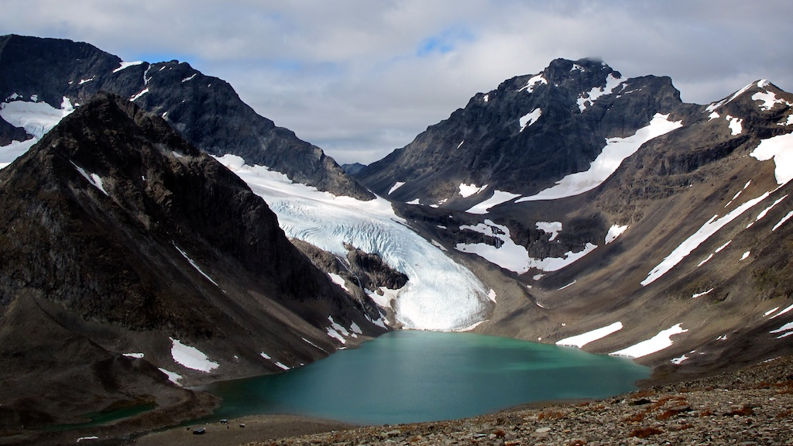{width=100%}
:::

Kungsleden (_The King's Trail_) is a four hundred kilometre marked route across
arctic Sweden, from Abisko at the top down through Lapland, Europe's last proper
wilderness. You can hike it when the snow melts in the late summer or
cross-country ski in the winter. 

::: {layout-ncol=2 .column-page}
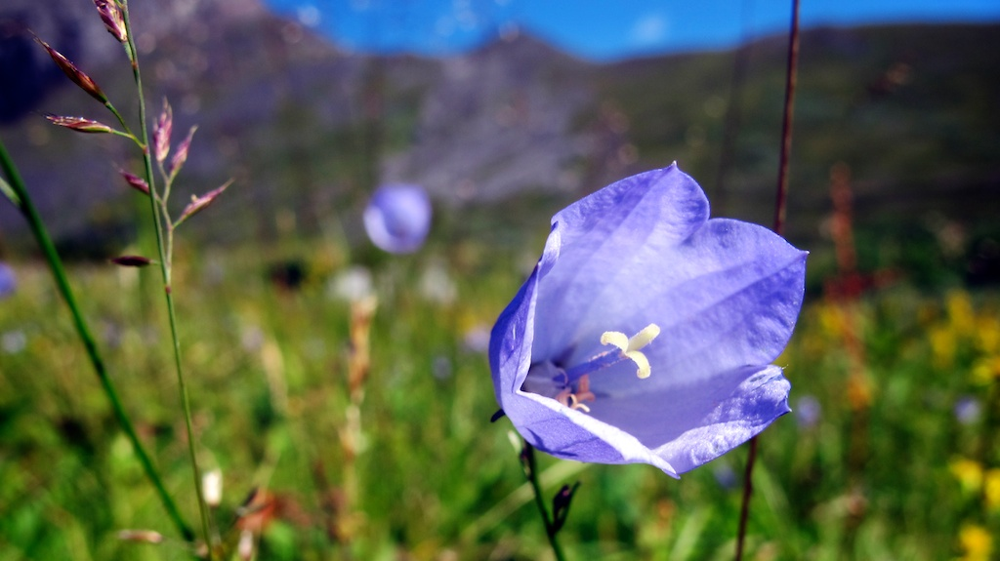


:::

The trail is well-maintained and the excellent [Svenska Turistföreningen
(STF)][stf] mountain huts are spaced roughly a day's walk apart, so it makes a
great way to explore this part of the world. But we weren't taking Kungsleden.
'A highway for tourists' says Nik. Kungsleden follows the valleys and we wanted
to be up in the mountains and in the wild, so we made use of Sweden's
*allmansrätten* (right-to-roam) to navigate our own journey through Lapland. 

:::{.column-page}
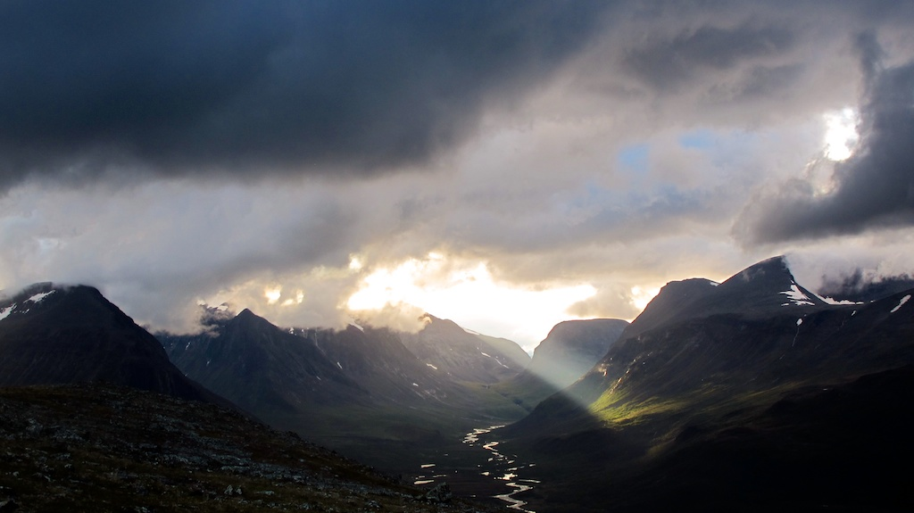{width=100%}
:::

We'd meet up with the trail later on at Kebnekaise, Sweden's highest mountain,
to climb to its summit and then continue south to the village of Kvikkjokk,
where a once-a-day bus goes to Murjek. From Murjek you can get a local train to
Jokkmokk. From Jokkmokk you get back on the the long train down to Stockholm. 

## Hit the North

:::{.column-page}
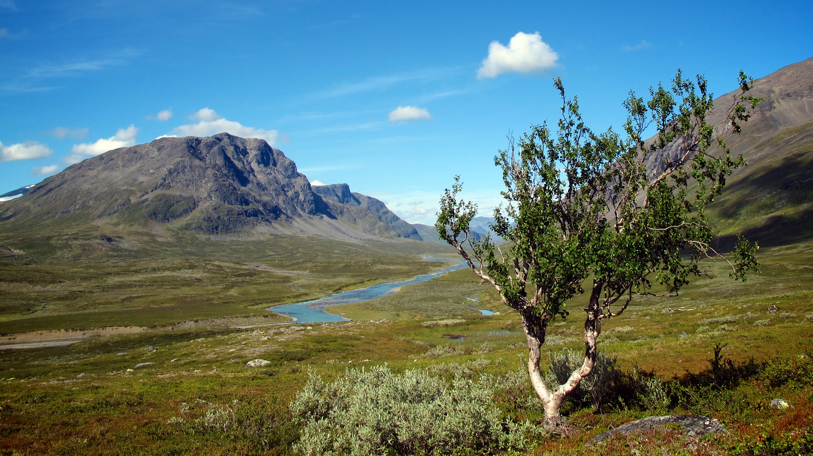{width=100%}
:::

Two weeks in the Arctic Circle in August means no darkness, with the sun slowly
dropping below the horizon but then rising again before the night has chance to
fall. Much of the day is a long dawn/dusk, when the blue glaciers seem to glow
and the dark jagged mountains are bathed in a pink ethereal light. We hiked at
midnight as easily as at noon. 

:::{.column-page}
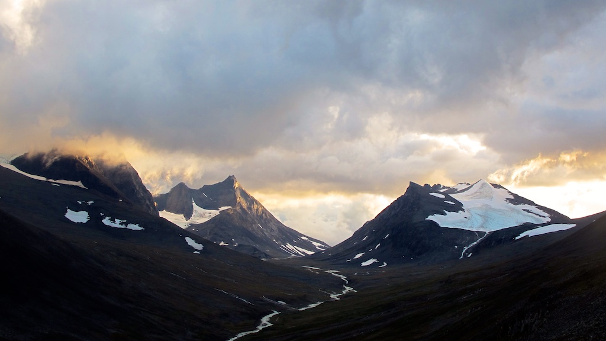{width=100%}
:::

<!-- 
<figure>
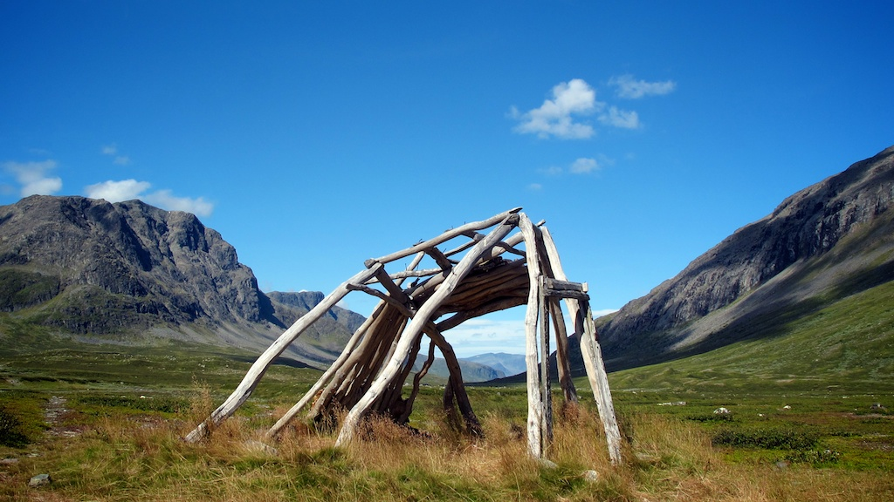
<figcaption>Tjäktiajåkka valley.</figcaption>
</figure> -->

Cutting our own path through the high mountain passes meant we found perfect
isolation, going without seeing another person for up to five days at one point.
And of course there's no phone signal, never mind WiFi, so no inboxes, no news
and no noise from the world for a couple of weeks. Just the time to explore a
quiet wilderness.

:::{.column-page}
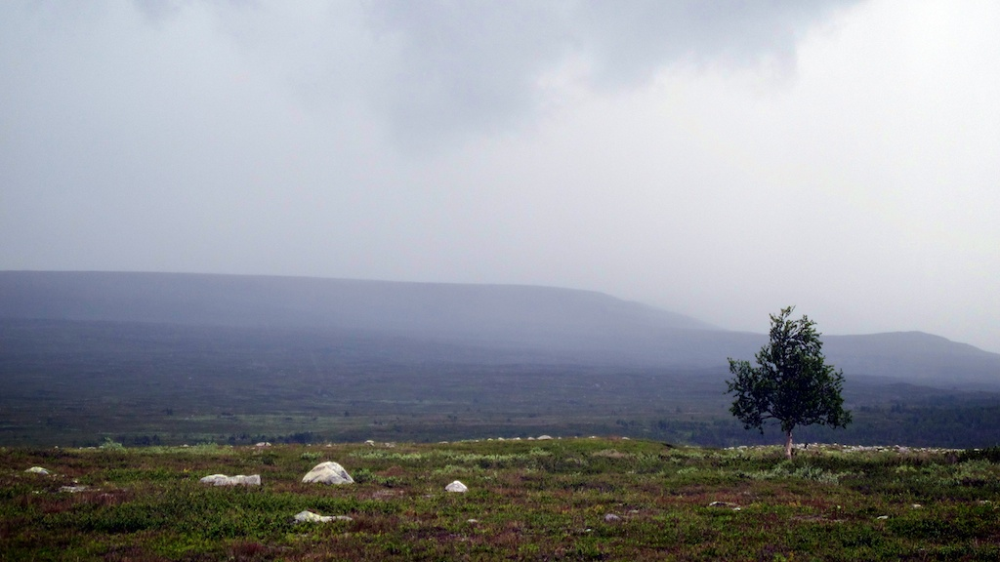{width=100%}
:::

To survive out there we had to carry everything we needed: the tent, stove,
food. We each carried about 25 kilos in our backpacks. Our meals had to be
basic: porridge or muesli for breakfast, with foraged blueberries to flavour. 

::: {layout-ncol=2 .column-page}
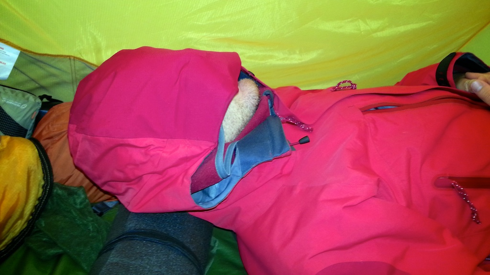

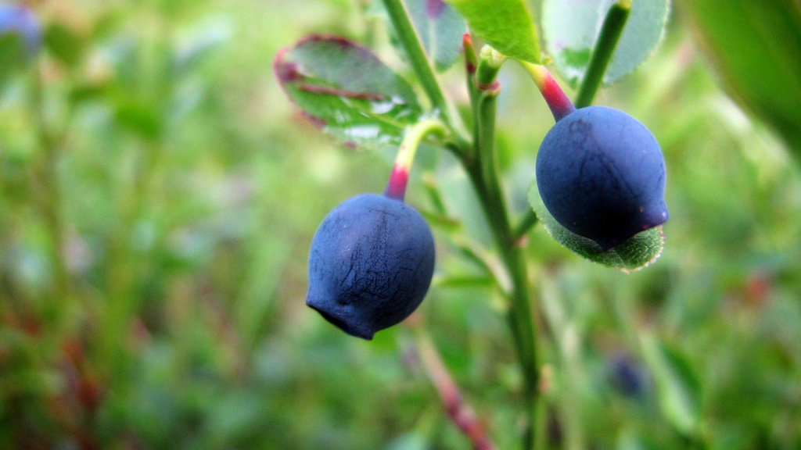
:::

Dark rye bread for lunch. Nuts, dried apricots and chocolate as we walked.
Macaroni cooked on the stove for dinner with a few different dried sauces.
Doesn't sound that exciting, but after a whole day of walking we always enjoyed
hot food.

<!-- 'Taco sauce' days were a treat. -->

<!-- ## Duolbagorni (river, mountain) -->

## I Follow Rivers


:::{.column-page}
{width=100%}
:::

Most of the snow had melted by August but the rivers were full, especially after
the days of heavy rain. Many times a day we'd come to a wide brimming stream and
have to find a place safe enough to jump across stones, or throw our bags to the
other side to make a running leap and hope we wouldn't end up swimming. 

<!-- <figure>
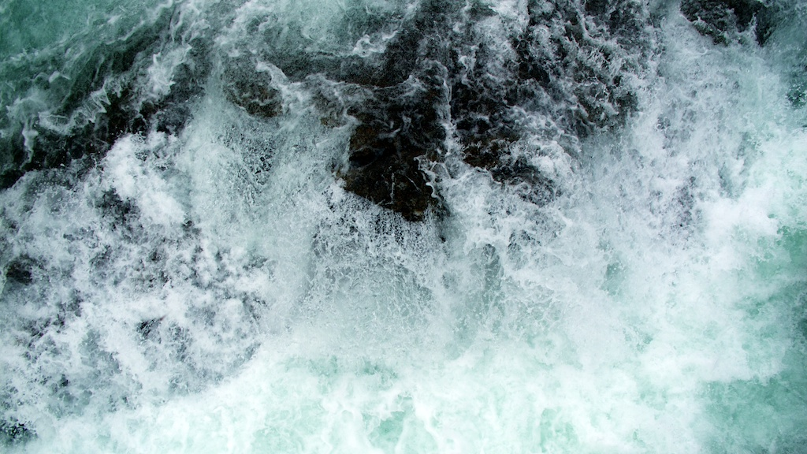
<figcaption>Crossing the bridge at Renvaktarstuga.</figcaption>
</figure> -->

:::{.column-page}
{width=100%}
:::

Having so much water around meant we didn't have to worry too much about
carrying litres --- it was everywhere, clean and delicious to drink. There's not
much better than a melting arctic glacier to quench a thirst. One afternoon the
sun came out and we took a shivery dip in the Tjäktiajåkka river. 

Some days we found comfortable places to camp. Others we had to take what we
could find, swiping at clouds of mosquitos in the wet valleys or sleeping
on a bed of rocky scree in the uplands.

::: {layout-ncol=2 .column-page}
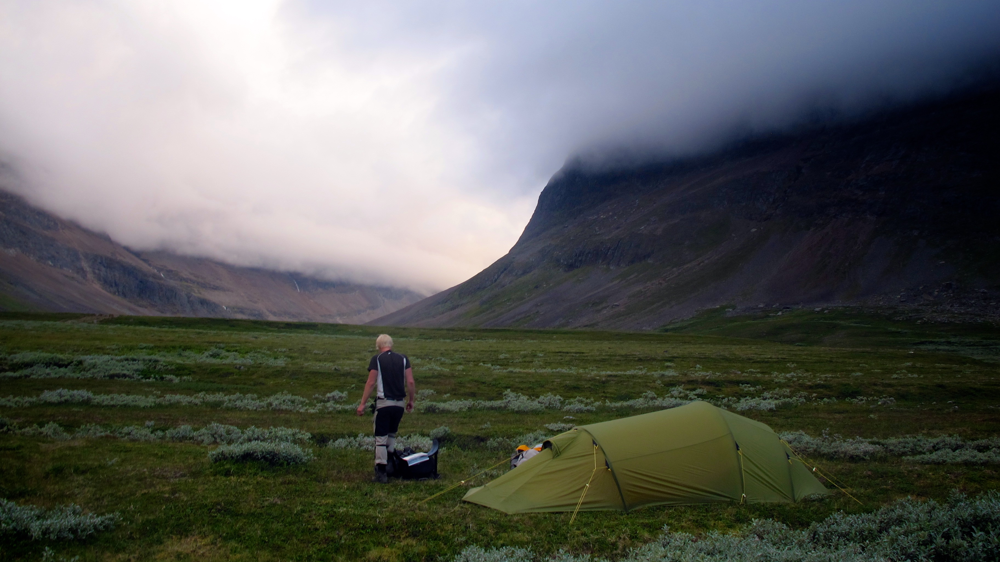


:::

Hoping to head off the insects with altitude on day 3, we set up camp at 1,350
metres on a narrow ledge over a huge valley. Soon after, we realised this might
not be the best place to be as a storm set in. I lay awake all night in the
deafening wind sure we were soon to be blown off into the abyss. Nik slept
unperturbed.

:::{.column-page}
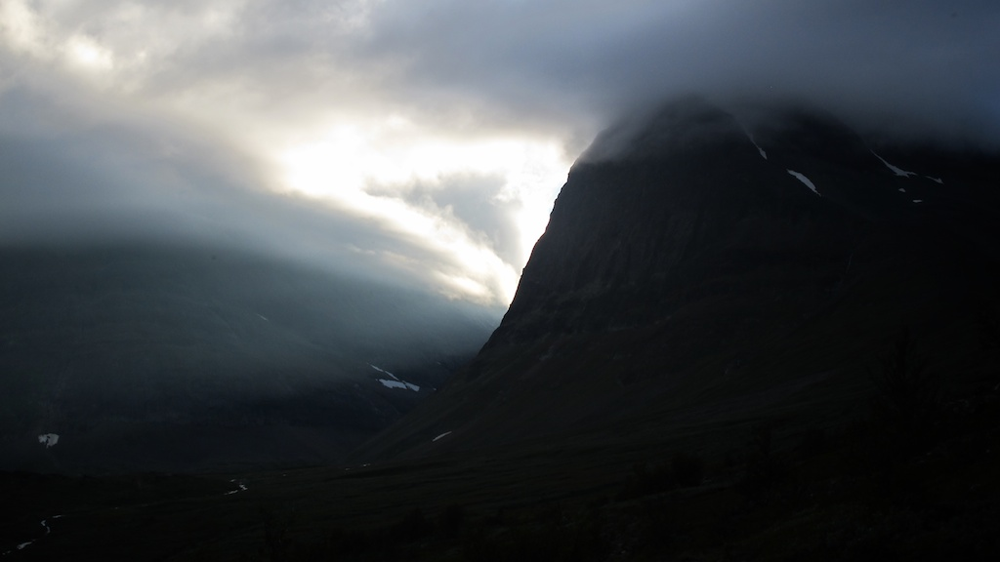{width=100%}
:::

The storm wouldn't let up in the morning so we broke camp in a raincloud, got
lost in the fog and bashed ourselves up a few times scrambling down over miles
of huge wet boulders, slipping with heavy packs and landing hard on shins and
knees. The other side of being off-grid is that if one of us broke an ankle we'd
have to set up camp and then the other would need to walk, possibly for days, to
get help. Thankfully we had no serious mishaps.

:::{.column-page}
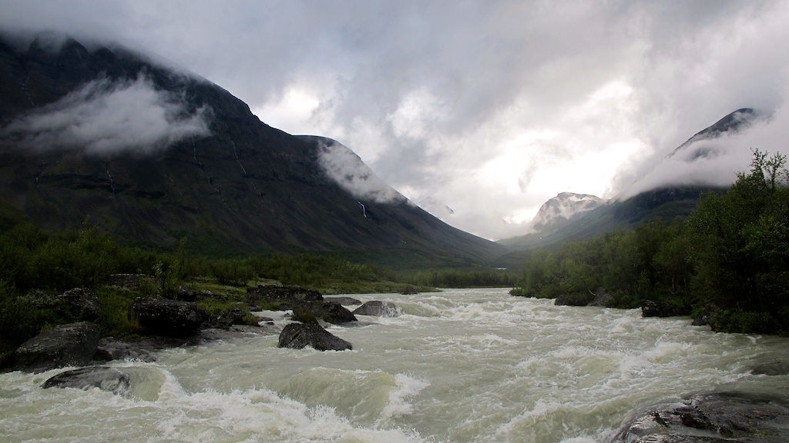{width=100%}
:::

In the afternoon the rain eased and we followed the swollen Visttasjokha river
down in its valley, admiring the clouds from below.

## Just an Animal Looking for a Home

<!-- <figure>
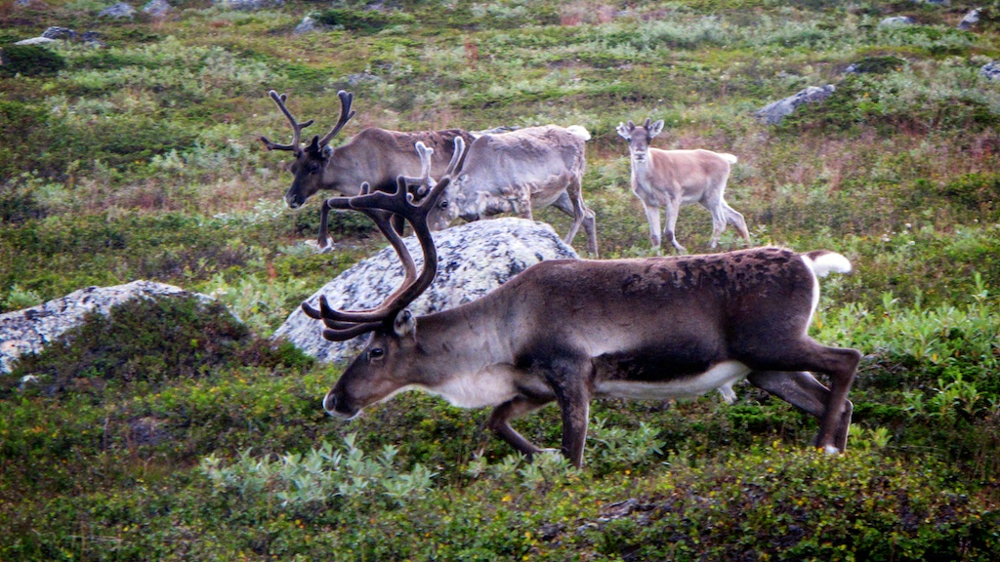
<figcaption>Reindeer at Aktse.</figcaption>
</figure> -->

:::{.column-page}
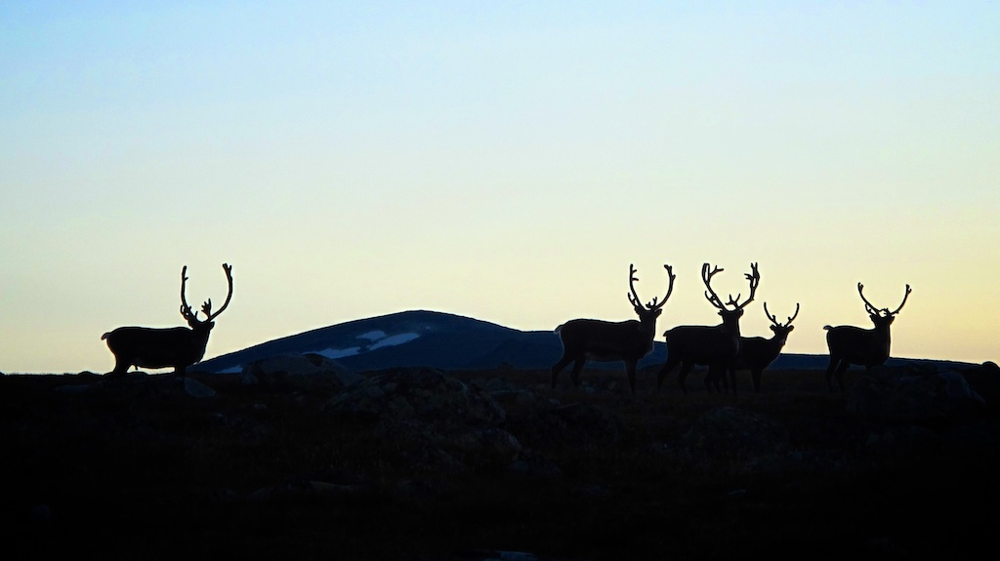{width=100%}
:::

'When I come to Wales again shall I stop every time we see a sheep?' With this I
sensed Nik was getting bored of me veering off excited to shoot photos every
time we saw reindeer. This was as wild as it got for us with fauna, though moose
and arctic foxes can be found in Lapland if you're lucky, and bears and wolves
if you're not.


::: {layout-ncol=2 .column-page}
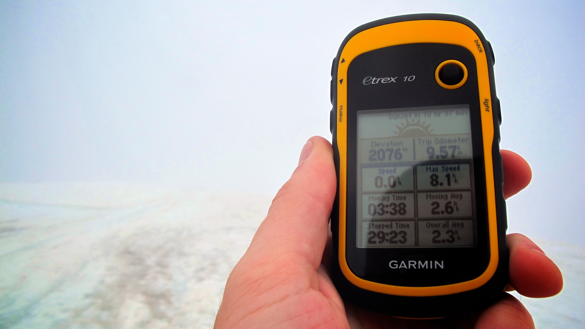

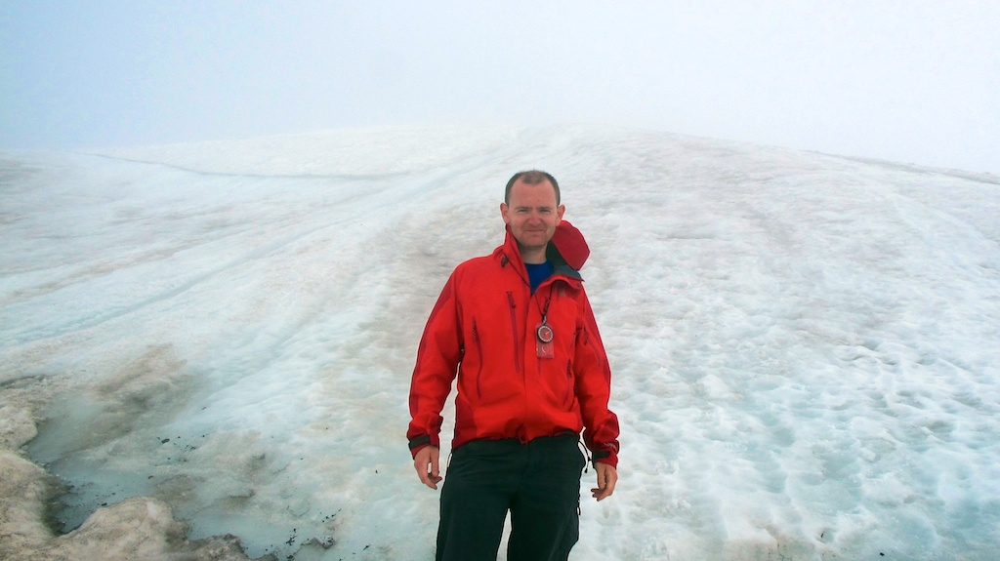
:::

Later in the trek we met back up with the trail to hike Kebnekaise, the highest
mountain in Sweden. Here there is a bit more traffic from the lodge in the
valley, which is only a 4 hour walk from the road at Nikkaluokta. It was a
change of pace being among other walkers.

## Those Planing Lakes Will Surely Calm You

:::{.column-page}
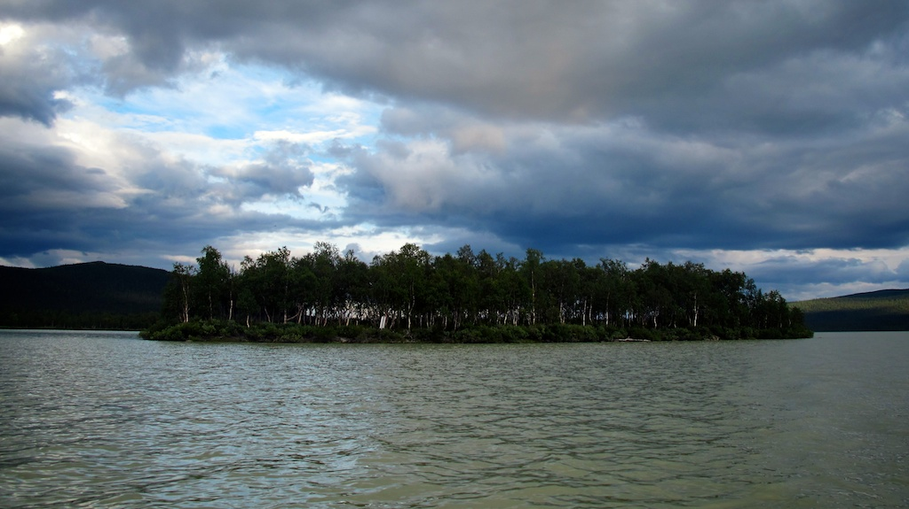{width=100%}
:::

A few times we got to lakes too big to go around, for which we had to find
marked on the map crossing points where rowboats are provided. At each lake
there are three boats. At least one has to stay on each side, so if you take the
last one you have to row across, tow one of the other boats back to where you
started and row again: three crossings. 

:::{.column-page}
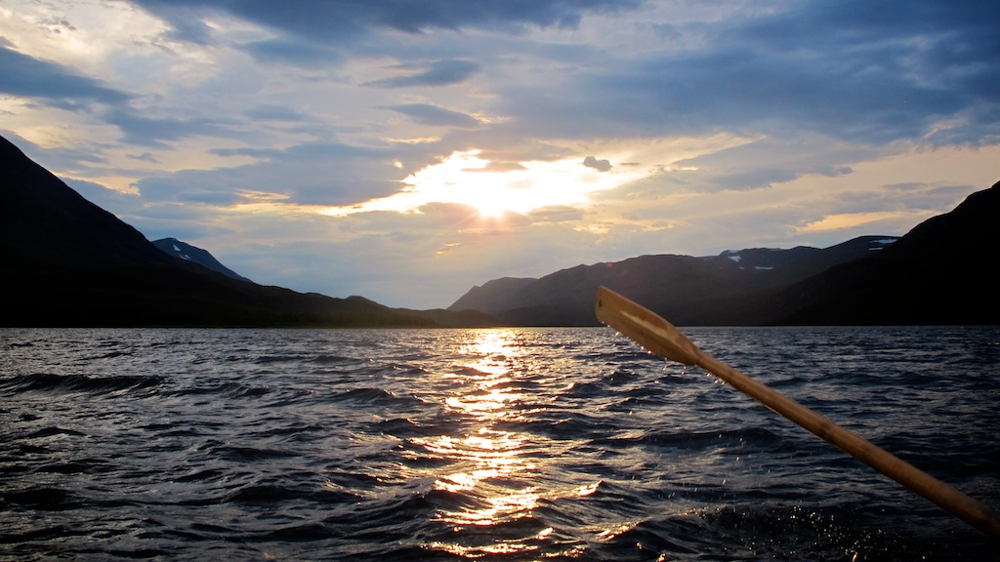{width=100%}
:::

The boats are heavy and designed to be sturdy and stable rather than easy to
row, so it could take an hour of rowing each way. We finished those days with
tired arms. At one lake, there's an alternative. Raise a flag on the beach and a
local Sami man will come over when he sees it and take you over in a motorboat
for 200 SEK (£19). Tempting as it was, we stuck to the oars and getting to
Kvikkjokk under our own steam.

:::{.column-page}
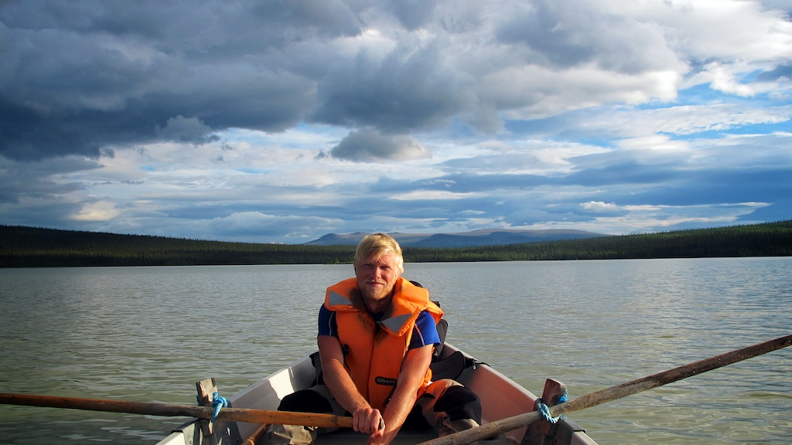{width=100%}
:::

## Gimme Shelter

In some remote places you can find STF cabins marked on the map. These are
something like Scottish mountain bothies, stocked with firewood and tinned food
for emergencies. If you need any of these provisions, they have identifiers for
you to pay for what you took by credit card when you're back home. We walked
long into the night to get to one, only to find it already occupied. We camped
nearby. Other than that, we never came across cabins at the right time to stay
the night.

::: {layout-ncol=2 .column-page}
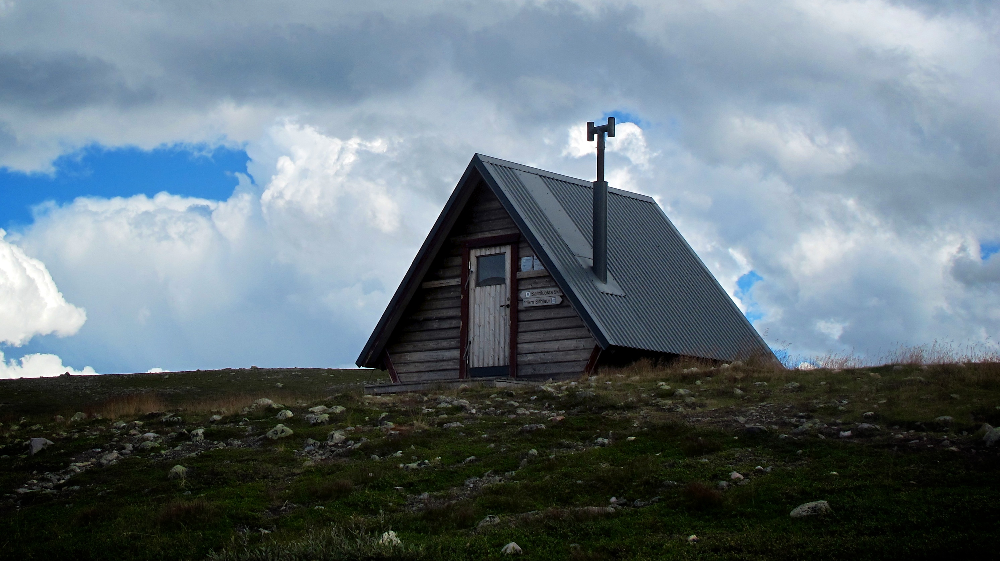

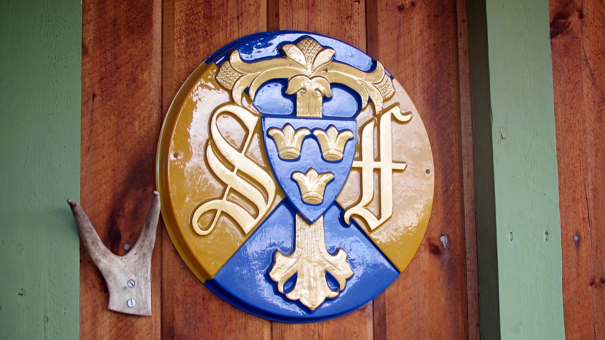
:::

Back on the trail, the bigger STF lodges can fit more people and have all the
essentials you need if you'd prefer not to camp: bunks, gas cookers, a
wood-burning stove and space to hang wet clothes. Many have volunteer hosts
(usually outdoorsy retirees) to look after you and sell a few provisions. Some
even have saunas, like this one under the waterfall at Teusajaure, though sadly
we didn't have time to stop here.

:::{.column-page}
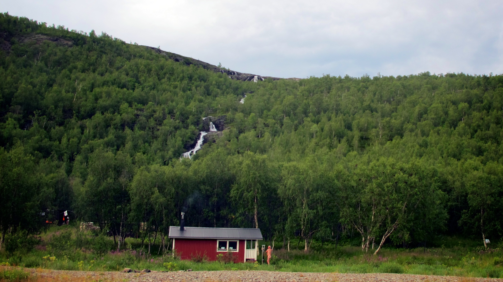{width=100%}
:::


After an incredible fortnight of solitude hiking over mountains, camping under
glaciers, rowing over lakes and swimming in freezing rivers, we finally came
down into the tiny hamlet of Kvikkjokk and treated ourselves to a first stay in
an STF hut and a bed as we waited for the bus to start the journey home. 

::: {layout-ncol=2 .column-page}
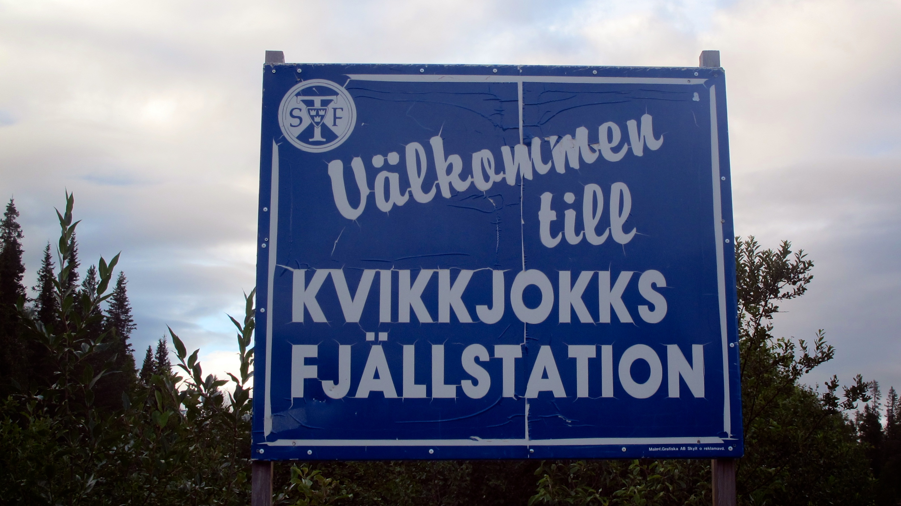


:::

::: {.column-margin}
Originally published in <a href="http://www.ernestjournal.co.uk">Ernest 
Journal</a>.
:::

The man at the hut looked up at us as we limped over, bedraggled. 'I'll get you
a beer and a sandwich. Which do you want first, the sauna or the wifi?'

:::{.column-page}
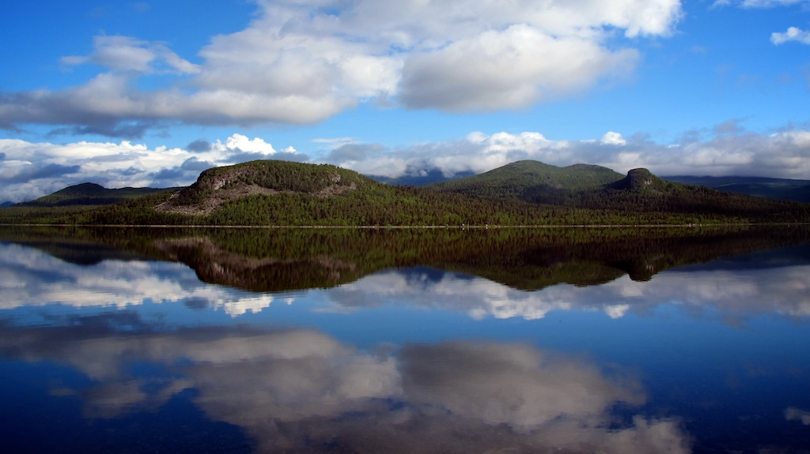{width=100%}
:::

<!-- <figure>
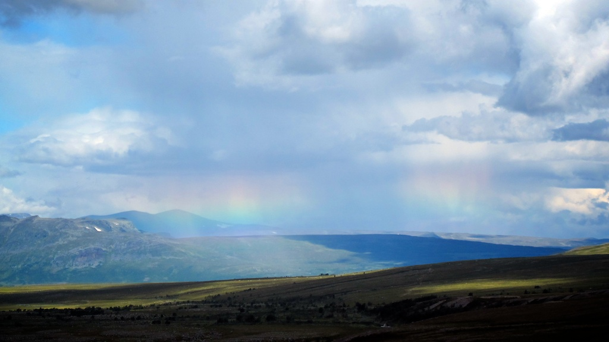
<figcaption>I don't know what you call this. Not a rainbow but a splitting of the spectrum in the rain.</figcaption>
</figure>

<figure>
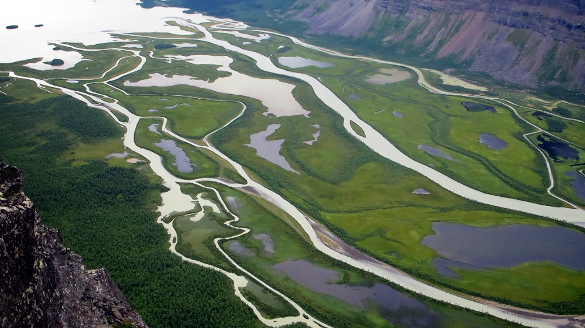
<figcaption>Looking down on the delta from Skierffe.</figcaption>
</figure> -->


[wiki-sm]: https://en.wikipedia.org/wiki/Scandinavian_Mountains
[stf]: https://www.svenskaturistforeningen.se